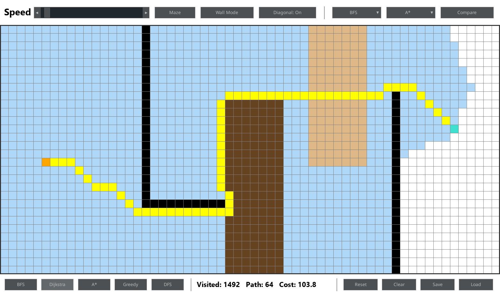

# Pathfinding Visualizer

An interactive Python/Pygame app that visualizes pathfinding algorithms exploring a grid step by step — watch the search frontier expand in real time, then see the resulting path highlighted once it's found.



## Features

- **5 algorithms**: BFS, Dijkstra, A*, Greedy Best-First, and DFS — run them on the same layout to compare how each one explores and whether it finds the cheapest path
- **Side-by-side comparison** — pick any two algorithms and watch them race on identical copies of your layout
- **Step-by-step visualization** with an adjustable speed slider, from a slow crawl to near-instant
- **Weighted terrain** in two tiers (light = cost 3, heavy = cost 8) — Dijkstra and A* route around costly cells, while BFS, DFS and Greedy ignore cost entirely (a deliberate way to see the difference)
- **Diagonal movement** — diagonal steps cost √2 and can't squeeze past the corner of a wall; A* switches to the matching octile heuristic
- **Maze generation** via randomized recursive backtracking, animated as it's carved
- **Save / Load** a layout to `saved_layout.json`
- **Stats readout** — cells explored, path length and total path cost after each run

## Download

A standalone Windows build is available on the [Releases page](https://github.com/abdullahgedik/pathfinding-visualizer/releases) — download `PathfindingVisualizer.exe` and run it, no Python install needed.

## Controls

| Action | Effect |
|---|---|
| Left-click / drag | Place start, then end, then paint with the current tool |
| Right-click / drag | Erase a cell back to empty (including start/end) |
| **Wall Mode → Light Terrain → Heavy Terrain** | Cycle what left-click paints |
| **Diagonal: On/Off** | Allow diagonal moves |
| **Maze** | Clear the grid and generate a random maze |
| **BFS / Dijkstra / A\* / Greedy / DFS** | Run that algorithm on the current layout |
| Two dropdowns + **Compare** | Run the selected pair side by side; **Back to Editor** returns |
| **Reset** | Clear search results, keep walls, terrain, start and end |
| **Clear** | Wipe the entire grid |
| **Save / Load** | Write or read the layout in `saved_layout.json` |
| Speed slider | Control how many search steps run per second |

Editing the grid while a search is running (or after it finishes) cancels it and clears its results, so what's on screen always matches the current layout.

## Setup

```bash
python -m venv venv
venv\Scripts\activate   # Windows
pip install -r requirements.txt
```

## Run

```bash
python main.py
```

## Testing

```bash
pip install -r requirements-dev.txt
pytest
```

The tests run without opening a window, since the algorithms never touch rendering. They cover:

- **Algorithms** — every algorithm finds a path on an open grid, reports none when blocked, and returns a chain of legal moves; Dijkstra routes around costly terrain and prices diagonals at √2; A* matches Dijkstra's cost on randomized weighted grids
- **Grid** — neighbor rules (bounds, walls, no corner-cutting), painting start/end/walls/terrain, path reconstruction and cost
- **Maze** — only walls and open cells are produced, and leftover terrain or search state is wiped
- **Save / Load** — round trips, mismatched grid sizes, and malformed files are rejected without touching the current grid

## Building the executable

```bash
pip install -r requirements-dev.txt
pyinstaller --onefile --windowed --name PathfindingVisualizer main.py
```

The executable is written to `dist/PathfindingVisualizer.exe`.

## Project Structure

```
main.py              # Window, UI panels and the main loop
grid.py              # Grid model: neighbors, move costs, painting, path reconstruction, save/load
node.py              # A single cell and how it's drawn
algorithms/          # One generator per algorithm, yielding after each step
    bfs.py  dijkstra.py  astar.py  greedy.py  dfs.py  maze.py
tests/               # pytest suite
```

Each algorithm is a Python generator: the main loop calls `next()` on it as many times per frame as the speed slider allows, which is what makes the search animate step by step.

## Tech Stack

- Python 3
- [pygame-ce](https://pyga.me/) for rendering and input
- [pygame_gui](https://pygame-gui.readthedocs.io/) for the UI panels (buttons, slider, dropdowns)
- [pytest](https://pytest.org/) for tests and [PyInstaller](https://pyinstaller.org/) for the standalone build
